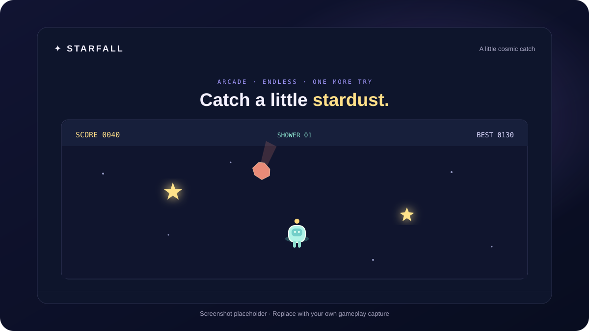

# Starfall

Starfall is a small, endless 2D arcade game about a star pilot, a pocketful of stardust, and one very busy meteor shower. Steer around the playfield, collect glowing stars, and stay clear of meteors for as long as you can. Your best score is saved in your browser.

> Screenshot placeholder: replace this image with a screenshot of the game when you have one.

## Play locally

There is no build step, package manager, or external service required. Download or clone this repository and open `index.html` in a modern browser. The game is made with plain HTML, CSS, JavaScript, and canvas drawings.

## Controls

- **Arrow keys** or **WASD** — move the pilot in any direction.
- **Space** — start, pause, resume, or play again.
- **P** — pause or resume.
- **Touch controls** — tap and hold the directional pad below the game.
- **Pause button** — pause on desktop or mobile.

Collect each golden star for 10 points. The shower level rises over time, making meteors fall faster and more often. Touch a meteor and the run ends; choose **Play again** to restart.

## Project files

- `index.html` — page structure and game interface.
- `styles.css` — responsive layout, colors, and button states.
- `game.js` — game loop, controls, scoring, and original canvas graphics.
- `assets/screenshot-placeholder.svg` — replaceable README image placeholder.

## Publish with GitHub Pages

This is a static site. In the repository settings, enable **GitHub Pages** for the branch containing `index.html` (usually `main`, from the root folder). No server configuration is needed.

## License

Released under the MIT License. See [LICENSE](LICENSE).

